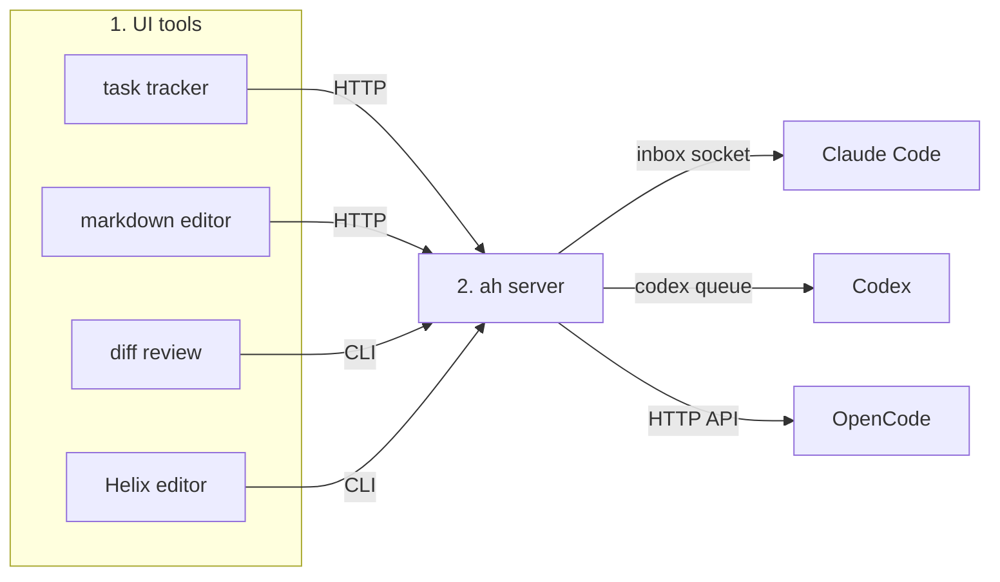

# ah

`ah` ("agent host") is a local server and CLI for spinning up UI tools that can talk to a running agent session.

This is experimental personal software, shared more as inspiration than as something to use off the shelf. If you don't want to use [Helix](https://helix-editor.com), [Rex](https://www.superlogical.com/updates/public-testing-beginning), [jj](https://www.jj-vcs.dev), or [skepsis](https://github.com/oxidecomputer/skepsis), no problem: have your agent replace Helix (I've included sample adapters for CodeMirror and Neovim), jj with git, or Rex with tmux.

## What it does (so far)

The video below shows the main things `ah` can do right now:

- A dashboard that stays in sync with the focused terminal tab, showing `jj` state and an interactive task tracker for work in progress
- A markdown editor that embeds a real Helix editor (running in a pty and connected to xterm.js over a WebSocket) alongside a rendered preview
- Diff review with skepsis
- Show arbitrary HTML for interactive explanations
- Set terminal tab titles based on what you're working on[^titles]

All of these have integrated chat, commenting, and/or buttons that talk back to agent sessions running in the terminal tab for that workspace.

[^titles]: This needs an LLM CLI. See [setup](docs/setup.md#tab-titles).

Detailed description of the video

1. I show the dashboard tool. It shows the `jj` log and switches directories automatically as I switch tabs in the terminal.
2. I tell Claude Opus 5.5 that I want to demo `ah` by writing a sonnet. I ask it to start a task tracker, then draft the poem, open it in the markdown editor, and diagram it in HTML.
3. The task tracker appears on the right side of the dashboard showing each of those steps.
4. The draft poem appears as rendered markdown in a new window.
   1. I open the editor pane on the left side of the window — it's a real Helix editor embedded in the web page.
   2. I highlight text in both the rendered markdown and in Helix and submit comments asking the agent for edits, which appear in the page after a few seconds.
   3. There is also a normal chat window embedded in the page.
5. I click Go on the "review diff in skepsis" task in the tracker on the dashboard, which causes the agent to open skepsis.
6. Comments in the diff viewer also go to the agent. When the agent makes the change I asked for, a banner appears with a refresh button saying the diff has changed. I click refresh and the change is there.
7. Then I go back to the tracker and click Go on "Diagram the poem". The agent generates an HTML page diagramming the poem and it opens in a new window. Highlighting and commenting work on that page too, and it has the same collapsible chat pane as the markdown editor.

https://github.com/user-attachments/assets/efe12195-3c77-4cbb-965d-558397481bb6

## Why

I like to work in the terminal: one stream of work in one directory in each tab, with panes for an agent, an editor, and a shell prompt. I love Helix. I love jj. I love [Ghostty](https://ghostty.org/)'s crisp rendering of [Berkeley Mono](https://usgraphics.com/products/berkeley-mono). But there are reasons to look over the fence with envy at GUI editors like [VS Code](https://code.visualstudio.com/) and [Zed](https://zed.dev), GUI agent harnesses like the Claude, ChatGPT, or [OpenCode](https://opencode.ai/) desktop apps, or meta-harnesses like [Herdr](https://herdr.dev/). Features like:

- **Markdown preview:** sounds small, but I write a ton of Markdown for GitHub issues and PR bodies, and I can't write properly for my audience unless I see it rendered like GitHub
- **Inline chat:** highlight a line and ask for a change
- **Dynamic UI:** if Claude wants to show you something in the desktop app, it can just pop open a browser pane
- **Manage many agents:** the standard agent GUI layout with the sidebar session list, the chat pane in the middle, and the content pane on the side; it's a cliché for a reason

I see all of this and think: I want that for me. But I want a hackable and terminal-centric version of it, and I want it to work the same regardless of which coding agent I happen to be using that day.

What I _didn't_ want to build is a general tool that anyone could pick up and use as-is. There are [hundreds](https://cmux.com/) of [tools](https://herdr.dev/) like that out there already. All of this is very specific to me, and the point is not at all to suggest you should work like me. You should work like you. The point is to show that you can think about how you want to work and just build it.

## Setup

Requires Node 24 and some agent hooks. The terminal integration uses Rex; pages opened directly by an agent work without it. As I said above, you'll probably want to adapt it to your setup. See [docs/setup.md](docs/setup.md).

## How it works

There are three main parts:

1. The UI tools: the most visible part, but the least specific to `ah`. A "hello world" tool would be a web page with a button that triggers an API call to `ah` saying "hello world" to an agent. The task tracker template with its Go buttons is barely more than this.
2. The server that receives messages from tools and routes them to agents. Each agent harness has its own way of receiving messages, and `ah` abstracts over those. Tools don't know what kind of harness they're talking to; they just run a CLI command or hit an API endpoint. To send a message back to the tool, the agent runs `ah message respond` with the file and request ID. [docs/messages.md](docs/messages.md) shows each message format.
   - **Claude Code** gives each session an [inbox socket](https://code.claude.com/docs/en/cross-session-messaging) that we write JSON to
   - **Codex** has `codex queue --thread <id>`
   - **OpenCode** runs a local server, and we post messages to `/api/session/<id>/prompt`
3. Connecting each tool to the right agent. When tools are started directly by an agent, there is no routing problem: harnesses pass a session ID to the command through an env var. But if I run `ah view README.md` by hand in the terminal, `ah` needs to find the agent running in that tab. So we have agents register with `ah` at session start and maintain a map of terminal panes to session IDs.

2 is really the core of `ah`. The tools can be whatever you want them to be, and 3 makes the tool-agent connections mostly automatic in my terminal, but there is no deep tie to the terminal. The Claude Code and Codex desktop apps work with it just fine.[^1]

[^1]: Tools started directly by the agent in Claude Code and Codex desktop pull the session ID from an environment variable, but neither one injects a session ID into their integrated terminal (https://github.com/anthropics/claude-code/issues/96959), which means we'd have to do some shenanigans to find the right session for that terminal. I'm sure it's doable, but I haven't done it because I don't use the desktop apps.

## Security

The server listens on `127.0.0.1:7420` and checks request headers to block DNS rebinding and requests from other web pages. HTML pages are served on a separate origin (`127.0.0.1:7421`) in order to prevent them from hitting the main API, which can message any agent and open windows.

However, HTML pages are not isolated from each other or from their own agent. A page's scripts can message the agent bound to that file, just like the chat panel does, and the agent treats those messages as coming from you. Pages can also load web assets from their own directory (except dot directories), and because all pages share the `7421` origin, a page that knows another page's URL can post into its thread. If an HTML page loads untrusted scripts, those scripts can talk to your agent.

There's no local authentication yet. Any local process that can reach port `7420` can impersonate the CLI and send prompts to your running agents. You probably shouldn't run `ah` on a multi-user machine or forward or tunnel ports `7420` or `7421`. I plan to add token-based authentication on the model of [Jupyter](https://jupyter-server.readthedocs.io/en/latest/operators/security.html).

## Prior art and inspiration

On August 28, I [built](https://bsky.app/profile/davidcrespo.bsky.social/post/3mua2lcwztk2r) a standalone prototype of the markdown editor. I had already built [skepsis](https://github.com/oxidecomputer/skepsis) and planned to connect it to agents as well. Then on August 31, I [saw](https://bsky.app/profile/davidcrespo.bsky.social/post/3mufofqyun22k) Ink & Switch's great [talk](https://www.youtube.com/watch?v=4UxGijnuXEs) from July about their [Patchwork](https://www.inkandswitch.com/project/patchwork/) project and the bigger picture clicked for me: instead of a markdown editor here and a diff viewer there, all of these could live on a shared substrate, a constellation of apps in a common "cinematic universe," as they call it. In their case, the substrate is a local-first database and sync engine powered by [Automerge](https://automerge.org/). For me, the substrate is simply the files I'm working on, the state of the terminal, and the agent sessions I have running.

For a great presentation of similar ideas, read Maggie Appleton's Sept 2026 talk [Planning with Agents](https://maggieappleton.com/planning-agents) and Ink & Switch's 2025 essay [Malleable Software](https://www.inkandswitch.com/essay/malleable-software/). And I can't leave out Bret Victor's 2013 talk [Media for Thinking the Unthinkable](https://worrydream.com/MediaForThinkingTheUnthinkable/), which has been a guiding light for my entire career. It's worth reading his rather negative take on LLMs in the 2024 [Dynamicland FAQ](https://dynamicland.org/2024/FAQ/#Relationships_to_other_technologies).

Finally, I got the name `ah` from Microsoft's [Agent Host Protocol](https://microsoft.github.io/agent-host-protocol/), which came up in a search for prior art. But `ah` is not an AHP implementation and I didn't follow its technical design.
